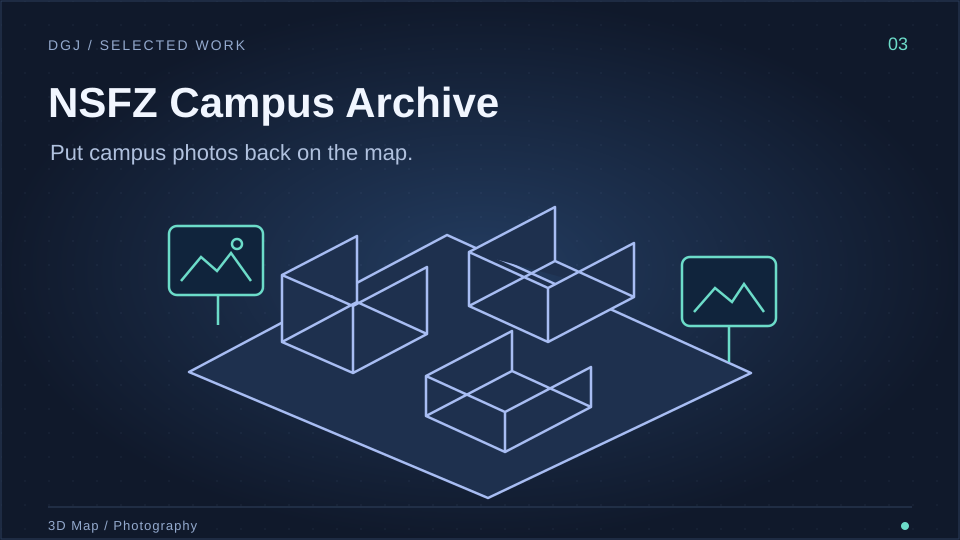
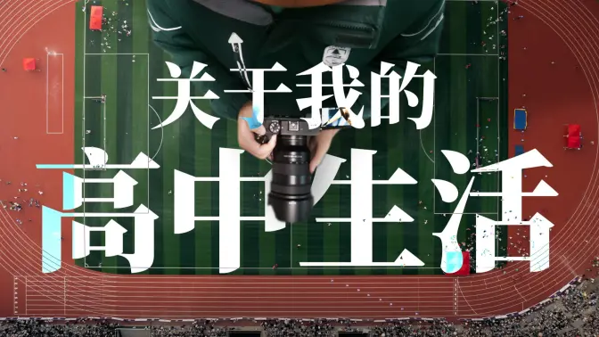

[简体中文](README.md) | **English**

<picture>
  <source media="(prefers-color-scheme: dark)" srcset="assets/hero-en-dark-flight.svg">
  <source media="(prefers-color-scheme: light)" srcset="assets/hero-en-light-flight.svg">
  
</picture>

# I love photography, make videos and build software.

I joined the **Industrial Design 3+1 program at Nanjing University of Science and Technology in 2026**, after graduating from Nanjing Normal University Affiliated High School that year. Photography is a favorite hobby: I shoot campuses, travel and everyday life, rework my desk and dorm, and build tools I use.

**[B站 / Bilibili](https://space.bilibili.com/406960195)** · **[Xiaohongshu](https://www.xiaohongshu.com/user/profile/6a3cf7f7000000000f038401)** · **[Douyin](https://www.douyin.com/user/MS4wLjABAAAA9_Z1Ybu7LalEW02TiBgTh5NdPN6kuqs6DcuEVvkcsYPg_iHtSoNFdLeSCI9opp5o)** · **[Repositories](https://github.com/DrivingGodJ?tab=repositories)**

## 01 / Things I've been building

<table>
<tr>
<td width="50%" valign="top">

<h3>DormCast</h3>

Stream Windows audio to phones and computers on the same LAN. Join in a browser, keep the host in the tray, and control broadcast volume centrally.

<a href="https://github.com/DrivingGodJ/DormCast/releases/latest">Download for Windows ↗</a> · <a href="https://github.com/DrivingGodJ/DormCast">Source</a>

</td>
<td width="50%" valign="top">

<h3>WorkBuddy QQ Agent Gateway</h3>

A “cyber groupmate” for tasks and university-group notices in QQ chats. A web console shows progress and manages sessions and subscriptions.

<a href="https://www.bilibili.com/video/BV1QnpP69EHE/">Watch the demo ↗</a> · <a href="https://github.com/DrivingGodJ/workbuddy-qq-agent-gateway">Source</a>

</td>
</tr>
<tr>
<td width="50%" valign="top">

<h3>NSFZ Campus Archive</h3>

Explore campus photos on a 3D map of Chaha'er Road. Search by season, time and floor, then compare the scene from the photographer's viewpoint.

<a href="https://drivinggodj.github.io/nsfz-campus-gallery/">Walk around ↗</a> · <a href="https://github.com/DrivingGodJ/nsfz-campus-gallery">Source</a>

</td>
<td width="50%" valign="top">

<h3>Shiguang</h3>

Turn public Bilibili favorites into a dated timeline, with search, random memories and an “on this day” view.

<a href="https://drivinggodj.github.io/shiguang-memory/">Revisit favorites ↗</a> · <a href="https://github.com/DrivingGodJ/shiguang-memory">Source</a>

</td>
</tr>
</table>

## 02 / Life through the camera

<table>
<tr>
<td width="33%" valign="top">

<strong><a href="https://www.bilibili.com/video/BV1sfgS6GEhy/">Half a summer rebuilding my desk ↗</a></strong>

</td>
<td width="33%" valign="top">

<strong><a href="https://www.bilibili.com/video/BV1X91BYJEoC/">Campus + color grading = ↗</a></strong>

</td>
<td width="33%" valign="top">

<strong><a href="https://www.bilibili.com/video/BV139jB6BELL/">A graduation video that stays with you ↗</a></strong>

</td>
</tr>
</table>

[More videos ↗](https://space.bilibili.com/406960195/upload)

## 03 / Tools I use

<table>
<tr><td>Photography &amp; design</td><td>  </td></tr>
<tr><td>Video editing &amp; color</td><td></td></tr>
<tr><td>3D modeling</td><td>  </td></tr>
<tr><td>Development &amp; version control</td><td>  </td></tr>
</table>
