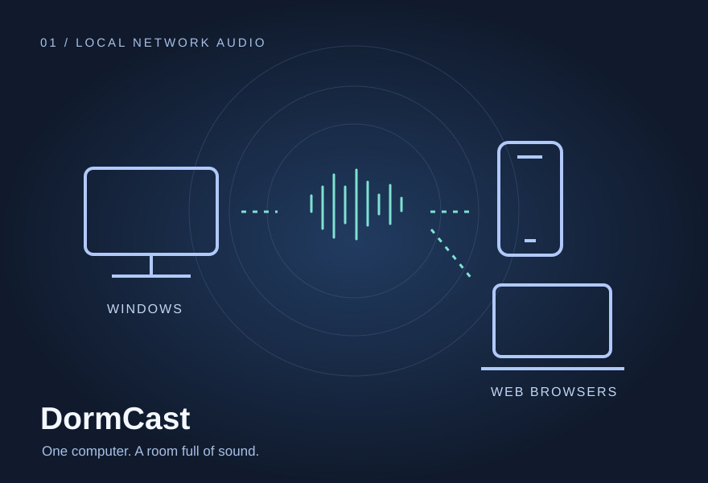
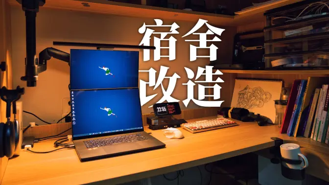

[简体中文](README.md) | **English**

<picture>
  <source media="(prefers-color-scheme: dark)" srcset="assets/hero-dark.svg">
  <source media="(prefers-color-scheme: light)" srcset="assets/hero-light.svg">
  
</picture>

# I'm DGJ. I study industrial design, make videos and build software.

I started **Industrial Design at Nanjing University of Science and Technology in 2026**, after graduating from Nanjing Normal University Affiliated High School the same year. I photograph campuses and travels, rework my desk and dorm, and use AI to help build tools I actually use.

**[Videos on Bilibili](https://space.bilibili.com/406960195)** · **[All repositories](https://github.com/DrivingGodJ?tab=repositories)** · **[Campus photo map](https://drivinggodj.github.io/nsfz-campus-gallery/)**

## 01 / Things I've been building

<table>
<tr>
<td width="50%" valign="top">

<h3>DormCast</h3>

I wanted my dorm to listen to the same music. This Windows tool broadcasts PC audio to browsers over the local network. Scan a QR code to join; the host stays in the system tray and controls the broadcast volume.

C# / WinUI 3 / Opus / WebRTC

<a href="https://github.com/DrivingGodJ/DormCast/releases/latest">Download for Windows ↗</a> · <a href="https://github.com/DrivingGodJ/DormCast">Source</a>

</td>
<td width="50%" valign="top">

<h3>Fanjian Notes</h3>

Read traditional Chinese while keeping the original page. Photograph a page and add small simplified-character hints, with page flattening, manual corrections and image export. OCR runs locally.

React / PaddleOCR.js / OpenCC / UVDoc / PWA

<a href="https://drivinggodj.github.io/fanjian-notes/">Try a page ↗</a> · <a href="https://github.com/DrivingGodJ/fanjian-notes">Source</a>

</td>
</tr>
<tr>
<td width="50%" valign="top">

<h3>NSFZ Campus Archive</h3>

Put campus photos back where they were taken. Explore the Chaha'er Road campus in 3D, find images by season, time of day and floor, then compare the model from the photographer's viewpoint.

<a href="https://drivinggodj.github.io/nsfz-campus-gallery/">Walk around ↗</a> · <a href="https://github.com/DrivingGodJ/nsfz-campus-gallery">Source</a>

</td>
<td width="50%" valign="top">

<h3>Shiguang · A Bilibili time machine</h3>

A growing favorites list made it harder to remember what I had saved. This BiliShelf-based adaptation adds a dated timeline, search, random memories and an “on this day” view of public favorites.

<a href="https://drivinggodj.github.io/shiguang-memory/">Revisit favorites ↗</a> · <a href="https://www.bilibili.com/video/BV1Fs8t6RERm/">Video</a> · <a href="https://github.com/DrivingGodJ/shiguang-memory">Source</a>

</td>
</tr>
</table>

## 02 / More tools for everyday use

| Project | What I use it for |
| :--- | :--- |
| **[WordDrill](https://github.com/DrivingGodJ/word-drill)** · [Practice ↗](https://drivinggodj.github.io/word-drill/) | Built around my CET-4/6 vocabulary study. Recognition and spelling have separate practice stages; FSRS schedules reviews across days. Works offline on a phone. |
| **[WorkBuddy QQ Agent Gateway](https://github.com/DrivingGodJ/workbuddy-qq-agent-gateway)** · [Video ↗](https://www.bilibili.com/video/BV1QnpP69EHE/) | A “cyber groupmate” that handles tasks in QQ groups and DMs, including university-group notices. A web console shows live progress, session controls and subscriptions. Extended from an open-source QQ Agent project. |
| **[Raphael Publish Desktop](https://github.com/DrivingGodJ/raphael-publish-desktop)** · [Download ↗](https://github.com/DrivingGodJ/raphael-publish-desktop/releases/latest) | My desktop adaptation of Raphael Publish. Organize FlowUs articles and images into local projects, choose a theme, preview, then copy styled content or export. Windows uses native WinUI. |

I also packaged workflows I've used into a **[China Travel Suite](https://github.com/DrivingGodJ/codex-china-travel-suite)** and a **[FlowUs Study Planning Suite](https://github.com/DrivingGodJ/codex-flowus-study-suite)** so I can use them again.

## 03 / Life through the camera

My Bilibili channel follows campus filming, desk and dorm makeovers, and the tools I build along the way.

<table>
<tr>
<td width="33%" valign="top">

<strong><a href="https://www.bilibili.com/video/BV1sfgS6GEhy/">Half a summer rebuilding my desk ↗</a></strong>

</td>
<td width="33%" valign="top">

<strong><a href="https://www.bilibili.com/video/BV1rR4A6jE2s/">Building a dorm I love ↗</a></strong>

</td>
<td width="33%" valign="top">

<strong><a href="https://www.bilibili.com/video/BV139jB6BELL/">A graduation video that stays with you ↗</a></strong>

</td>
</tr>
</table>

Other films include **[a rainy walk in Xiuqiu Park](https://www.bilibili.com/video/BV15A7GzDEu7/)** and **[Dongjiang Lake](https://www.bilibili.com/video/BV1PGgw6uEYi/)**, alongside racing-game edits. [More videos ↗](https://space.bilibili.com/406960195/upload)

## 04 / Tools and current practice

| Work | What I'm using or learning |
| :--- | :--- |
| Photography and editing | Lightroom, Luminar and Photoshop; DaVinci Resolve for campus, travel and seasonal talking-head videos. Recent work on *Frost's Descent* and *Beginning of Winter* includes subtitles, supporting footage and AI-generated opening/closing motion. |
| Industrial design and modeling | Interested in automotive styling; learning Rhino / NURBS, Blender and Alias, starting with proportion, form and surfaces. |
| Software and automation | AI-assisted development with tools such as Codex; GitHub for source and releases. Recent projects use C# / WinUI 3, JavaScript / TypeScript, React and local browser processing. |

These are personal projects and open-source adaptations. See each repository for upstream credits, licenses and practical limitations.
