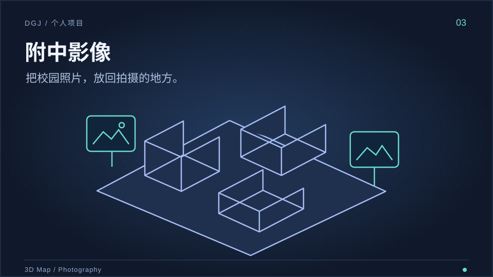

**简体中文** | [English](README.en.md)

<picture>
  <source media="(prefers-color-scheme: dark)" srcset="assets/hero-zh-dark-flow.svg">
  <source media="(prefers-color-scheme: light)" srcset="assets/hero-zh-light-flow.svg">
  
</picture>

# 喜欢摄影，也拍视频、做软件。

南京理工大学 **2026 级工业设计3+1专业在读**，南师附中 2026 届毕业。爱好摄影，常拍校园、旅行与日常；也折腾桌面、宿舍和自己会用的小工具。

**[B站 / Bilibili](https://space.bilibili.com/406960195)** · **[小红书](https://www.xiaohongshu.com/user/profile/6a3cf7f7000000000f038401)** · **[抖音](https://www.douyin.com/user/MS4wLjABAAAA9_Z1Ybu7LalEW02TiBgTh5NdPN6kuqs6DcuEVvkcsYPg_iHtSoNFdLeSCI9opp5o)** · **[全部仓库](https://github.com/DrivingGodJ?tab=repositories)**

## 01 / 最近做的东西

<table>
<tr>
<td width="50%" valign="top">

<h3>宿舍之音 · DormCast</h3>

电脑放歌，同一局域网的手机和电脑扫码打开网页收听。主机常驻托盘，统一调整广播音量。

<a href="https://github.com/DrivingGodJ/DormCast/releases/latest">下载 Windows 版 ↗</a> · <a href="https://github.com/DrivingGodJ/DormCast">源码</a>

</td>
<td width="50%" valign="top">

<h3>WorkBuddy QQ Agent 网关</h3>

让“赛博群友”接住 QQ 群聊与私聊里的任务，整理大学群通知；网页面板显示进展，管理会话与订阅。

<a href="https://www.bilibili.com/video/BV1QnpP69EHE/">演示视频 ↗</a> · <a href="https://github.com/DrivingGodJ/workbuddy-qq-agent-gateway">源码</a>

</td>
</tr>
<tr>
<td width="50%" valign="top">

<h3>附中影像</h3>

把校园照片放进察哈尔路校区的三维地图，按季节、时段和楼层寻找，再回到拍摄者的视角对照。

<a href="https://drivinggodj.github.io/nsfz-campus-gallery/">走进校园 ↗</a> · <a href="https://github.com/DrivingGodJ/nsfz-campus-gallery">源码</a>

</td>
<td width="50%" valign="top">

<h3>拾光 · B站收藏时光机</h3>

把 B站公开收藏夹变成按日期翻看的时间线，加上搜索、随机回忆和“那年今日”。

<a href="https://drivinggodj.github.io/shiguang-memory/">翻翻收藏 ↗</a> · <a href="https://github.com/DrivingGodJ/shiguang-memory">源码</a>

</td>
</tr>
</table>

## 02 / 镜头里的生活

<table>
<tr>
<td width="33%" valign="top">

<strong><a href="https://www.bilibili.com/video/BV1sfgS6GEhy/">半个暑假的桌面改造 ↗</a></strong>

</td>
<td width="33%" valign="top">

<strong><a href="https://www.bilibili.com/video/BV1X91BYJEoC/">校园 + 调色 = ↗</a></strong>

</td>
<td width="33%" valign="top">

<strong><a href="https://www.bilibili.com/video/BV139jB6BELL/">什么毕业视频的后劲这么大？ ↗</a></strong>

</td>
</tr>
</table>

[更多影像 ↗](https://space.bilibili.com/406960195/upload)

## 03 / 手头的工具

<table>
<tr><td>摄影&amp;设计</td><td>  </td></tr>
<tr><td>视频剪辑与调色</td><td></td></tr>
<tr><td>三维建模</td><td>  </td></tr>
<tr><td>开发与版本管理</td><td>  </td></tr>
</table>
